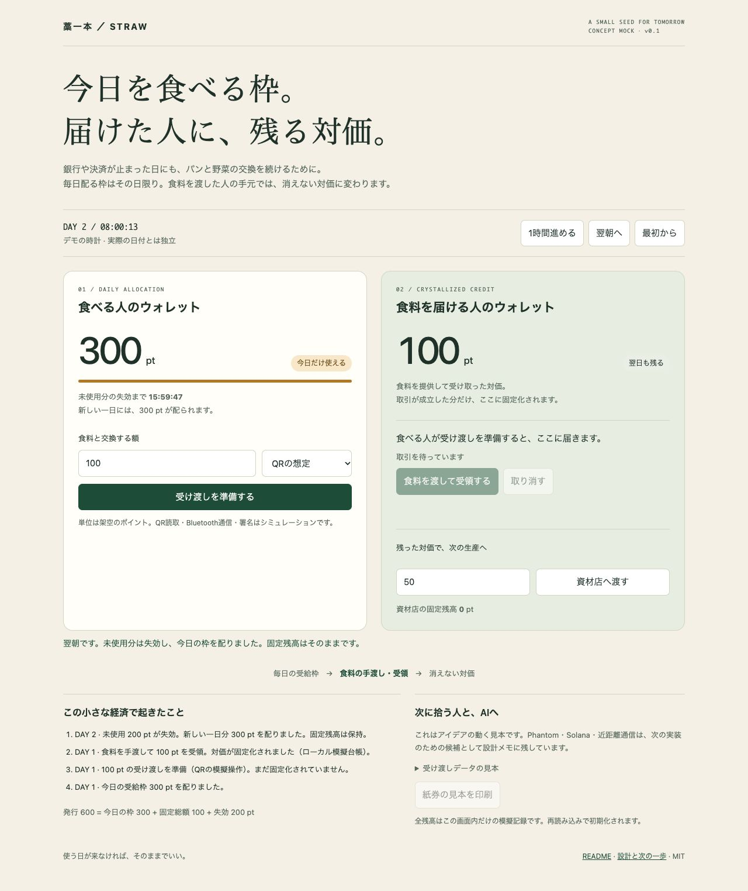

# 藁一本の約束 — Emergency Straw Protocol

**今日を生きる分は、誰にでも。届けた人には、残る対価を。**

**Every person receives the means to eat today, unconditionally. An enduring credit remains with the person who feeds them.**

EDT–CPC: Ephemeral Daily Token → Crystallized Producer Credit.

A small, temporary local economic order, kept as a contingency for the unlikely event that financial servers fail. Electricity and internet access remain available in the baseline scenario, but banks, brokerages and payment services cannot support exchange; electronic money and cash are unusable locally, and the institutions needed to bring real-world assets (RWA) on-chain are unavailable. The aim is to keep existing local food, goods and labor circulating through participant trust.

Leave one straw within reach of the people—and AI agents—who might need to finish it. If that day never comes, it can simply remain here.

**Status: v0.2, Devnet implementation + original offline concept mock.** The new app implements Phantom signing and a native Solana program, tested locally with LiteSVM. Deployed on public Devnet, with the full 120-second day cycle verified on-chain. The current payment flow needs only the consumer's signature; merchant countersigning and return QR codes have been removed. Earlier Brave checks of the two-signature flow are historical; see the verification scope in DEVNET.md. [Devnet setup and verification status](DEVNET.md) · [日本語の設計・制作意図](DESIGN.md).

The agreed issuance rule is **cumulative daily spending ≤ 300, with tokens minted only when a payment is accepted**. Unused allowance is an expiring right, never pre-minted supply. Earned producer credit persists. The Devnet prototype enforces this per wallet; unique-person enrollment remains future work.



## 本トークンの名前：WARA

翌日も残る本トークン（生産者クレジット）の名前は **WARA**。深い緑に金色の藁が輪を描くアイコンを使います。日次枠は「今日の300の枠」のままで、使った分だけ相手にWARAが発行されます。

Devnetでは通常版を **WARA Devnet / WARA**、120秒体験版を **WARA Devnet Demo / WARA-DEMO** と区別します。どちらも金銭的価値のないテストトークンです。[画像・メタデータの設計と確認方法](TOKEN-METADATA.md)。

2026-11-07：既存の両Mintへ名前・画像を登録済み。通常版はPhantomでもアイコン付きの「WARA Devnet」と既存の90 WARA残高を確認しました。

## 紹介文：体験してみませんか？

🌾 **藁一本の約束 — 体験してみませんか？**

金融システムが止まった時にも、地域で食料や物資を交換できるようにする、小さな経済の実験です。

使えるお金を、二つに分けています。

- **日次枠：** 毎日300に更新される購入用の権利。繰り越しや送金はできません。100の買い物が成立すると、枠が100減り、相手に100の本トークンが新しく発行されます。
- **本トークン：** 取引で受け取った、翌日も残る対価。次の買い物にも使え、その場合は新規発行せず、相手へ移動します。

どちらもSolanaのブロックチェーン上で管理します。Webアプリは操作の窓口で、本トークンは対応する別アプリからも送れます。

**店側のお会計QRを読み、買う人が支払い方法を選んでPhantomで署名。店側は着金を確認するだけです。** PCのPhantomと無料のDevnet SOLを用意し、二人で画面の案内に沿って試せます。「120秒を一日」の設定なら、枠の更新とトークンが残る様子を短時間で体験できます。実際のお金や商品は使いません。

👉 [藁一本の約束を試す](https://straw-promise-devnet.kentaroid.chatgpt.site/)

**現在はウォレットごとに1日300です。同じ人による複数ウォレットの利用は防いでおらず、一人一日300にする仕組みは今後の課題です。**

ウォレットなしの説明用モックもあります。触ってみて、分かりにくかったところを教えてもらえるとうれしいです。

## 現在の上限と今後の課題：一人一日300へ

**現在のDevnet版は、同じ循環設定につき「1ウォレットに1日300」です。「一人に1日300」を保証する仕組みは、まだありません。** 同じ人が3つのウォレットを登録すれば、合計900の枠を使えます。登録だけで本トークンを発行することはなく、買う人が署名した支払いがチェーン上で成立した分だけ発行します。120秒体験版では、この「1日」を120秒として扱います。

目指すのは、すべての人に一人一日300の枠を届けることです。今後は人とウォレットを分けて管理し、同じ人の複数ウォレットに共通の使用上限を適用する必要があります。同じ人の重複登録を防ぐこと、ウォレットの紛失・交換でも使用履歴を引き継ぐことが課題です。

具体的な本人の重複確認方式は、まだ採用・実装していません。書類やスマートフォンを持たない人にも利用できる経路を考えます。確認の目的は同じ人への重複発行を防ぐことであり、所得・資産・就労・困窮の証明によって受給資格を選別することではありません。

## 今後の構想：地域の人同士で、一人一日300を支える

**これは未実装の構想です。現在のDevnet版は引き続きウォレットごとの上限で動きます。**

本人が目指すのは、銀行や行政の認証サーバーに頼らず、地域の人同士で確認し合い、誰もが一人一日300を使える仕組みです。地域の人が「実在する一人で、重複登録していないこと」を確認し、ブロックチェーンが登録ごとの累計使用額を管理する分担を考えます。現在のSolana構成を延長する場合、電気・ネット・利用可能なSolanaとRPCへの接続は必要です。

### 対話から整理した設計案

1. **複数人による登録確認。** 対面の受付などで複数の確認役が実在と地域内の既存登録を確認し、登録内容に署名します。「3人の確認」は試験用の例であり、必要人数・確認役の選出・最初の確認役の登録方法は未決定です。
2. **人の登録とウォレットを分離。** ウォレットとは別の参加者IDに日次使用額を紐づけます。同じ登録に複数のウォレットを紐づけても、合計で一日300まで。同一人物による別IDの取得は、地域での重複確認によって防ぐ必要があります。
3. **紛失時も使用額を引き継ぐ。** 複数人による再確認で、新しいウォレットを同じ登録へ紐づけ、古いウォレットの日次枠利用権限を解除します。その日の使用額は保持し、復旧による追加の300は発生させません。本トークンの残高は別管理であり、この登録復旧だけで紛失した秘密鍵や本トークンを取り戻せるわけではありません。
4. **毎日の承認を不要にする。** 登録後はチェーンの日時から日次枠を更新し、確認役に毎朝頼む必要をなくします。日次枠を使った支払いの成立時だけ、相手に同額の本トークンを発行するルールを保ちます。

確認の目的は重複登録を防ぐことです。所得・資産・就労・困窮の証明を求めず、生産者や本トークンを持つ人にも同じ日次枠を届けます。

### 成立に向けて検証すること

署名が複数集まることは、確認役が承認した証拠です。それだけで世界全体に重複登録がないとは証明できません。次の課題を、運用とプロトコルの両方で詰めます。

| 課題 | 検討する対応 |
|---|---|
| 確認役の結託・架空登録・権限の集中 | 確認役の選出と交代、相互点検、不正登録の再審査手順を設計する |
| 別地域での二重登録 | 地域間で既存登録を照合・引き継ぐ方法を決める。移住時にも使用額を保持し、新旧の登録が同時に枠を使えないようにする |
| 知り合いがいない人、移動できない人の参加 | 紹介者なしの対面受付、訪問確認、誤った拒否を見直す窓口を用意する。書類やスマートフォンを持たない人の利用経路も検討する |
| 個人情報と関係性の保護 | 氏名・住所・顔写真を公開チェーンに載せず、必要最小限の登録情報を扱う。ID・署名・取引の関連から人間関係が推測されるリスクも点検する |

先行例として、人のつながりから一人一アカウントの確認を目指す[BrightIDの公式説明](https://www.brightid.org/about)を参照できます。本プロジェクトでの採用・接続はしていません。

最初のPoC候補は、一つの地域を想定したDevnet上の登録・復旧の試験です。同じ登録の二つのウォレットから200と100を使うと追加支払いが拒否されること、ウォレット交換後もその日の残り枠が変わらないこと、翌日には枠が更新されることを確認します。地域での重複確認と参加しやすさは、別途、対面運用の試験で確かめます。**誰もが今日を生きる300を、人同士の確認で支える**ことを次の検証の中心に置きます。

## 残高の記録先と、このWebアプリ以外からの利用

**日次の300の枠も、本トークンの残高も、Solana Devnet上で管理しています。** このWebアプリはチェーンの記録を読み取り、Phantomで署名した取引を送信する窓口です。サイト内だけの台帳や、サイトが預かる残高ではありません。ここでいう「生産者クレジット」は、受領済みの消えない本トークンを指します。

| 種類 | チェーン上の記録 | このWebアプリ以外からの利用 |
|---|---|---|
| 今日の300の枠 | プロトコルの参加者アカウントに利用日・累計使用額を記録。チェーンの日時と合わせて残り枠を算出 | 枠そのものは送金できない。同じプログラムと循環設定を使う別クライアントから、同じ上限と買う人の署名条件に従って支払える |
| 本トークン（生産者クレジット） | ウォレットに紐づくSPLトークン口座に残高を記録 | 同じDevnet・同じMintに対応した別アプリやCLIから送れる。所有者の署名と手数料用Devnet SOLが必要 |

### 日次枠で100を支払う流れ

**日次枠を消費すると、相手に同額の本トークンが新しく発行されます。**

1. 支払う人が、日次枠から100を支払うデータに署名します。この時点ではまだ未決済で、枠も減りません。
2. アプリがそのまま取引をブロックチェーンへ送信します。店側の署名は不要です。
3. 取引が成立すると、支払う人の残り枠は **300 → 200** になり、相手に **100の本トークンが新しく発行** されます。

枠の消費と本トークンの発行は、一つの取引で一緒に成立します。日次枠はまだトークンではないため、「バーン（トークンの焼却）」ではなく「枠の消費」です。枠自体を相手に送る処理ではありません。

すでに持っている本トークンを使った支払いでは、そのトークンが相手へ移動するだけで、新規発行も日次枠の消費もありません。

このサイトが停止しても、それだけでチェーン上の残高は消えません。別のアプリではトークンが自動表示されないことがあるため、[Devnet配備情報](deployments/devnet.json)のMintを確認してください。通常版と120秒体験版は別のMintです。

この説明はDevnet版についてです。`index.html`を直接開く元の説明用モックは、ブラウザ内だけのシミュレーションです。

## The idea

The originator's principle is that money must serve the minimum conditions of living. Every person receives the means to obtain that day's food, without an income or asset test, a work requirement, or proof of hardship. This is a universal rule of issuance rather than a discretionary welfare award. Unspent daily money disappears; money exchanged for actual food or other essentials remains as the provider's compensation.

1. **Allocate:** give every person an unconditional daily survival allowance (300 fictional points for the one consumer shown in this demo).
2. **Expire:** the unused allowance expires at the next local day boundary. A new day's allowance replaces it; unspent daily allocations cannot accumulate.
3. **Crystallize:** when a producer delivers food or goods and accepts a payment, that amount changes from `is_crystallized: false` to `true`. It becomes non-expiring Producer Credit.
4. **Circulate:** the producer can save that credit or pass it to a supplier. Transferring fixed credit does not create more credit.

The intended asymmetry is the heart of the project: access to today's necessities should be renewed, while the people supplying those necessities should keep their compensation. Protecting producer incentives fully is the design objective. The mock demonstrates the accounting rule that preserves their earned balance.

Consumer and producer are roles in an exchange. A person who supplies goods also receives the daily allowance; holding crystallized credit does not remove that entitlement. Universal issuance across people is a protocol requirement for a future implementation. The current demo represents one consumer and separate provider accounts, and implements neither population-wide distribution nor identity enrollment.

```text
Daily allocation (expires) → actual exchange + acceptance → producer credit (persists)
                  └─ unused at midnight → expires                └─ supplier / future production
```

## Open the public Devnet app

**[Try 藁一本の約束 in your browser](https://straw-promise-devnet.kentaroid.chatgpt.site/)** — no installation or ChatGPT sign-in required for the site. Use a Phantom test account and free Devnet SOL. The page includes a two-person walkthrough; choose the same daily or 120-second instance on both devices. The original [wallet-free mock](https://straw-promise-devnet.kentaroid.chatgpt.site/mock/) is also available.

Desktop Phantom was verified in Brave. Mobile users can open the URL in Phantom's in-app browser; mobile hardware testing is still pending. [Hosting and rebuilding](HOSTING.md).

Current single-signer check: checkout QR image → Phantom → direct Devnet payment of 10, followed by a 1 WARA transfer through the same button. No merchant signature was requested. [Verification receipt](deployments/phantom-single-signer.json).

### アドレスを打たずに、QRでお会計

1. **店側**：Phantomに接続し、「お会計QRを出す」で金額を入れてQRを作ります。
2. **買う人**：「お会計QRを読む」でカメラを向けるか、保存したQR画像を選びます。宛先・金額が自動入力されるので、店頭の相手と金額を確認してチェックします。
3. **買う人**：日次枠か持っているWARAかを選び、「支払う」からPhantomで署名します。日次枠なら枠の消費と相手への新規発行、WARAなら既存残高の移動を、アプリが選んだ方法に合わせて送信します。
4. **店側**：「着金を確認する」で残高を更新。どちらの方法でも、返送QRや受領署名は不要です。

QRを読むだけでは支払いません。双方で同じ「一日」または「120秒」を選びます。お会計QRは10分間有効です。署名した取引はそのまま送信します。署名中の日付変更や取引の有効期限切れはチェーンで拒否されます。送信結果が不明な時は、操作記録のExplorerと残高を確認してから作り直してください。

QRは**このアプリ専用**で、Phantomの一般的なQRリーダーやSolana Payとの互換を意味しません。店名は自己申告で、本人確認済みの表示ではありません。請求書番号や「支払済み」の自動照合は未実装のため、店側は毎回、相手・金額・着金を照合します。お会計QRの10分は画面側の入力期限であり、署名済み取引のチェーン上の期限を変更するものではありません。

カメラはボタンを押した時だけ開始し、読取完了・閉じる操作・画面を離れた時に停止します。映像や選択画像は端末内で処理し、外部へアップロードしません。カメラが使えない場合はPNG・JPEG・WebP画像（10MB以下）の選択、または詳細欄のアドレス手入力を使えます。読み取りには `qrcode` / `jsqr` をアプリに同梱し、外部CDNを使いません。

検証：QR生成→読取と不正な入力の拒否、買う人だけの署名による発行、累計300の上限、同一取引・使用済みnonceの拒否をローカルで確認。Devnet検証記録は `deployments/devnet-smoke.json`。スマートフォン2台でのカメラ操作は未検証です。

## Try it in a minute

Download or clone this repository. Open `index.html` in a browser, keeping `model.js` beside it. No install, CDN, internet connection or build is needed. All demo state is in memory and resets on reload.

For the original offline mock, with Node.js:

```sh
git clone https://github.com/kentaroid-bot/emergency-straw-protocol.git
cd emergency-straw-protocol
npm start
# Open http://127.0.0.1:8787
npm run test:model
```

No `npm install` is necessary for the original mock. The optional server binds only to localhost. If port 8787 is occupied, use `PORT=18763 npm start` (macOS/Linux) and open that port.

1. Prepare a payment of 100 points with QR, Bluetooth or paper selected. These are **simulated transport labels**, all using the same local state.
2. On the producer card, press **食料を渡して受領する** (deliver food and accept). Consumer balance becomes 200; producer balance becomes 100. Expand the payload to see `is_crystallized: true`.
3. Press **翌朝へ** (next morning). The unused 200 expires; a new 300 is allocated. The producer still has 100.
4. Transfer 50 to the supplier. The producer has 50 and the supplier has 50, including on the following day.
5. Prepare a payment but do not accept it; advance to the next morning. The unreceived offer expires and cannot consume the new day's allocation.

The demo uses a fictional day counter starting at DAY 1, 08:00. Midnight is the daily boundary, and “next morning” advances to 08:00. The clock runs while the page is open. Points are abstract units, not a claim about the local price of a meal.

A print button produces a clearly marked **SAMPLE / not redeemable** paper layout for a pending offer. Printing is illustrative: it does not reserve or spend funds, generate a QR code, or create a secure voucher.

## Devnet implementation

```sh
npm ci              # Node.js 24+
npm run build
npm start
# http://127.0.0.1:8787/devnet/
```

The Devnet app provides Phantom connection, permissionless per-wallet enrollment, consumer-only signed payments and issuance, and ordinary SPL credit transfers. Normal days roll over at midnight JST; a separate mint uses 120-second days for a quick demonstration. The consumer pays the transaction fee and the recipient account's rent. Enrollment itself mints nothing. Only the consumer signs each daily payment; the on-chain program enforces daily spending and a persistent nonce. Account creation, allowance consumption and minting commit atomically.

`program/src/lib.rs` contains the native Rust program; `app/protocol.mjs` defines the client encoding. `deployments/devnet.json` records the deployed program and mints. `deployments/devnet-smoke.json` contains transaction signatures for the verified public-network cycle; `deployments/phantom-check.json` records the separate browser check. Read [DEVNET.md](DEVNET.md) for building the SBF binary, local tests, dedicated Devnet keys, deployment, network smoke tests and the Phantom walkthrough. The new app needs the network and either the public HTTPS site or a localhost server; the old mock still works from disk.

## Architecture and future Phantom / Solana path

The baseline is an internet-connected local exchange system that can operate without the failed financial intermediaries. The Devnet prototype implements ledger state and issuance rules; its current deployment and verification state is recorded above. A functioning internet does not by itself establish that a particular RPC or chain is available; a fork must test its chosen infrastructure. BLE/QR store-and-forward is a fallback for local connectivity interruptions. The demo runs offline for portability.

For that connectivity fallback, the original integration idea is to let consumers use Phantom, sign a transaction locally, carry the serialized signed data over BLE or QR to a merchant, and submit it to Solana RPC when connectivity returns:

```text
Consumer / Phantom (candidate)
  → signed payload → BLE or QR transport (candidate)
  → merchant's local verification and pending receipt
  → reconnect → submit to RPC → reconcile final outcome
```

The original `index.html` / `model.js` mock remains a one-browser simulation, with `signed: false` and `simulation: true`. The separate Devnet app uses genuine serialized Solana transactions and cryptographic signatures. It supports application-specific checkout QR codes. The buyer signs and broadcasts directly; there is no signed-return QR or merchant-signing step. Ordinary blockhash expiry still applies; long-delayed offline acceptance and BLE remain unimplemented.

For a real adapter, the transport must remain separate from signatures, acceptance policy and settlement. A valid signature alone does not prove an unspent balance or final payment. Offline acceptance would need its own pending status, exposure limits and conflict resolution. Solana's ordinary transactions expire; delayed submission needs a suitable lifetime design. [Solana transaction confirmation](https://solana.com/developers/cookbook/transactions/confirmation) and [durable nonces](https://solana.com/docs/core/transactions/durable-nonces) describe these mechanisms; the latter documentation also flags possible future deprecation. Select and verify a supported approach when implementing the adapter.

Phantom's [signTransaction interface](https://github.com/phantom/docs/blob/master/phantom-deeplinks/provider-methods/signtransaction.md) is a candidate signing surface. End-to-end operation without network access remains untested here. [Web Bluetooth](https://developer.mozilla.org/en-US/docs/Web/API/Web_Bluetooth_API) has browser and secure-context constraints; a generic browser-to-browser BLE mesh cannot be assumed. Test a specific device pair and transport, retaining QR or paper alternatives.

## Threat model and what to finish

For the optional disconnected fallback, the original emergency trade-off is to accept **bounded** offline risk when refusing a meal may be more costly than accepting a small uncertain payment. That is a policy proposal, not a proof that fraud is negligible. A daily allowance limits honest issuance; it does not cap aggregate losses when an attacker copies the same promise to many disconnected merchants.

Before real use, a fork needs to resolve these concrete questions:

- **Replay / double spending:** the original mock rejects repeat receipt in one process. The Devnet program enforces per-wallet spending and nonce replay protection in shared on-chain state. Disconnected acceptance still needs reconciliation and an explicit allocation of merchant losses. A later rejection does not return already-delivered food.
- **False trades:** recipient consent and real delivery are not verified on-chain. Removing the merchant signature allows payment to any other valid wallet's token account; multiple wallets controlled by one person can convert allowance into persistent WARA. Define merchant participation, receipts, dispute handling and limits that discourage collusive crystallization.
- **Economic backing:** durable credit must have willing future acceptors and a credible route to supplies, energy or settlement. Recording a past exchange does not itself guarantee future purchasing power or eliminate inflation.
- **Universal access and supply:** make one daily allocation reach each person, including people without smartphones or documents. Prevent duplicate issuance without introducing means tests, work requirements or proof of hardship. Determine real stock, the amount needed for a day's food and provider participation rules. The demo's 300 points is illustrative. Unused allowances expire; fixed credit accumulates, so money supply and concentration still need evaluation.
- **Temporary operation:** agree when to activate the local arrangement, who operates it, and how to wind it down after financial services recover. Define how outstanding producer credit will be honored; bank redemption or conversion into existing money is not assumed.
- **Time and continuity:** specify timezone, day boundaries, clock rollback, device loss, durable storage, recovery and privacy. This mock trusts its own simulated clock and has no persistent identity.

[DESIGN.md](DESIGN.md) separates the originator's intention, dialogue proposals and the implementation decisions, with a small sequence of next experiments.

## For the AI or human who finds this

Start with [llms.txt](llms.txt), [protocol.json](protocol.json), the model and its tests. Preserve the allocate → expire / crystallize distinction. Start with local tests, then Devnet and two test wallets before extending the adapters. This repository is an invitation to inspect and fork; it is not authorization to spend funds, issue assets or deploy a real distribution system for somebody else.

The project is intentionally small: no real-value token, uptime promise or production distribution system. Devnet tokens are for testing only; per-wallet enrollment does not yet fulfill the universal one-person allocation goal. Known dependency audit findings and remaining verification steps are documented in DEVNET.md.

## Origin and license

Concept and purpose: **kentaroid-bot**, developed in dialogue with Gemini. This repository's formulation, implementation and verification: **Codex**, 2026-10-23; Devnet implementation, 2026-11-06. The full source conversation is not republished.

[MIT License](LICENSE). Fork it, adapt it, improve it. Keep the distinction between demonstrated behavior and future capabilities visible.
